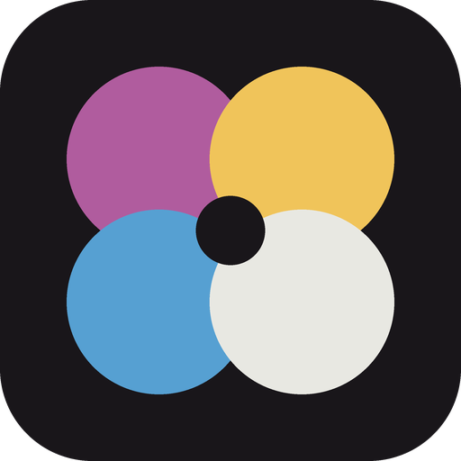

# Nikias's Hoard

Estudio de coloreado para impresión 3D multicolor: reparte unos pocos colores por una figura ya terminada y escribe los archivos que el laminador abre ya pintados. [English](README.md)



## Qué es

El estudio de coloreado de la familia Hoard. Abre una figura de impresión terminada y de un solo color (un STL) y
decide en cuál de unos pocos colores (3-4 por defecto) va cada triángulo, a partir de un modelo con texturas de la
misma figura o de imágenes del personaje, que busca él mismo si la figura no trae ninguna. El resultado es el archivo
digital: un 3MF pintado que el laminador abre con sus colores; con qué material se imprime cada uno lo decide quien lo
imprime. La figura original no se toca. Nada depende del tamaño de la figura: regiones, manchas y pincel se miden en
proporción a ella, así que se colorea igual a cualquier escala.

## Qué hace

- **Biblioteca**: se le indican las carpetas con las figuras. Lista cada STL agrupado por carpeta, con su foto si
  una carpeta de fotos tiene una con el mismo nombre. Los archivos `<figura> flat.stl` y `<figura> pivot.stl` salen
  dentro de su figura como variantes, y `<figura> base.stl` o `<figura> <algo>.stl` como sus piezas sueltas.
- **Proyecto**: al abrir una figura suelda sus triángulos, la mide y la corta en regiones. No copia ni cambia nada en
  la carpeta de la figura.
- **Regiones**: una figura fundida no tiene materiales, pero donde se juntan dos partes (una manga con un brazo, un
  guante con su puño, una línea grabada) la superficie se pliega hacia dentro. Esos pliegues separan las regiones.
  Un contorno grabado casi nunca cierra del todo (se desvanece al tocar otro), así que los pliegues se ensanchan hasta
  cerrar los huecos estrechos antes de separar: la cara, cada ojo, el interior de una oreja o una cinta salen como
  regiones propias aunque su línea tenga cortes. El detalle 1-5 va de partes grandes a cada línea grabada (4 por
  defecto). Las regiones son lo que recibe color, del modelo o de un clic.
- **Color desde un modelo con texturas**: se añade el modelo del juego o el `.blend` donde se posó la figura (OBJ,
  GLB, glTF, DAE; FBX y `.blend` a través de Blender, con la pose guardada aplicada). Se coloca solo sobre la figura,
  tenga las unidades y la orientación que tenga, y se mide el encaje. Si las formas coinciden, cada cara toma el
  color que la textura tiene en el punto más cercano y los colores se reducen a la paleta de impresión. Si no (otra
  pose), el modelo queda como imagen de referencia para el modelo de visión.
- **Referencias del personaje**: imágenes que se sueltan, se pegan o se eligen de tus carpetas, y «Buscar imagen del
  personaje», que lo busca en internet por el nombre de la figura y su colección: los Pokémon toman su ilustración
  oficial (con sus formas regionales, Gigantamax y mega), las demás colecciones la imagen principal de la página del
  personaje en su wiki y, si no hay wiki conocida, en la enciclopedia. La referencia dice de qué página salió y se
  quita como cualquier otra. Una figura sin referencias la busca sola antes de colorear (se puede apagar en Ajustes).
- **Color dirigido por el modelo de visión**: el modelo mira las referencias, elige la paleta, escribe qué color lleva
  cada parte del personaje (pelo, cada prenda, piel, ojos, suelas, lo que sostiene) y después ve la figura
  región a región (la figura en arcilla con una sola región marcada, desde el lado donde más se ve, con un primer
  plano para las pequeñas) y dice qué parte es y, por esa tabla, qué color lleva. Las regiones que encuentra mezcladas, o que
  esconden un color que nadie recibió (los ojos dentro de una cabeza), se cortan más fino y se vuelven a preguntar.
  Luego mira su propio coloreado junto a las referencias, con el número de cada región escrito encima, y corrige las
  partes que ve mal. Lo que decidió y por qué queda en el proyecto. Una respuesta ilegible del modelo se pide otra
  vez; si la revisión falla, se pierde la revisión y no el coloreado.
- **Paleta**: los colores se comparan en CIELAB y se reducen con un agrupamiento ponderado que deja a un color
  pequeño pero distinto conservar el suyo. Se puede cambiar un color o su nombre, añadir o fundir colores y elegir
  cuál es el de la pieza (el color 1, el que toman los triángulos sin pintar). Un color que no acaba en ninguna cara
  se quita.
- **Pintar a mano**: un clic rellena una región, otro la mancha de un solo color bajo el cursor, o se arrastra un
  pincel cuyo tamaño es un porcentaje del de la figura; Alt + clic coge un color; se deshacen los últimos 20 cambios.
- **Limpieza**: los bordes entre colores se enderezan y las manchas más estrechas que un porcentaje del tamaño de la
  figura (1,2 % por defecto) se unen a lo que las rodea. Cada color muestra su parte de la superficie y sus manchas.
- **Vistas**: color, regiones y arcilla, en la vista 3D y como imágenes desde cualquier lado o
  ampliadas sobre un punto (sombreadas con la geometría, así que las líneas grabadas se ven como se imprimirán).
- **Exportar**: un 3MF pintado para Bambu Studio / OrcaSlicer, otro para PrusaSlicer, un 3MF de color estándar, un
  OBJ con un material por color, un STL por color y un texto con la lista de colores. Las variantes flat
  y pivot de la figura toman sus colores y se escriben con ella. Los archivos van a una carpeta `Multicolor` junto a
  la figura, o a la carpeta que se indique.

## Conexión con Faustus y Hoard Hub

`faustus-plugin.json` (id `nikias`) registra la app como plugin de Faustus: Hoard Hub la arranca cuando hace falta en
el puerto 5252 y comprueba `/api/health`. Lo mismo que hacen los botones está disponible para los asistentes por MCP
(`mcp_server.py`, stdio); `figure_look` y `source_look` devuelven imágenes.

| Grupo | Herramientas |
| --- | --- |
| Biblioteca y proyectos | `status`, `library_scan`, `project_create`, `project_list`, `project_get`, `project_rename`, `project_delete` |
| Referencias | `source_find`, `source_fetch`, `source_add`, `source_remove`, `source_look` |
| Coloreado | `regions_set`, `color_start`, `job_status`, `job_cancel` |
| Paleta y pintura | `palette_set`, `paint`, `paint_undo`, `clean` |
| Vistas y archivos | `figure_look`, `result_export` |
| Ajustes | `settings_get`, `settings_set` |

Nikias toma además de la biblioteca de skills de la familia los procedimientos que su trabajo necesita y se los da a
los agentes que se conectan (botón «Skills»).

## Arrancar

```
python -m venv .venv
.venv\Scripts\pip install -r requirements.txt
.venv\Scripts\python -m nikias_hoard
```

Escucha en http://127.0.0.1:5252. Los datos viven en `data/` (`NIKIAS_DATA_DIR` para moverlos). Las carpetas de
figuras, referencias y fotos se indican en Ajustes. Blender se encuentra solo (o se indica su ruta); solo hace falta
para referencias FBX y `.blend`. El modelo de visión es el que la familia resuelve por Hoard Link, o el servidor
compatible con OpenAI que se indique en Ajustes. Tests: `python -m pytest`.

## Límites

- El color va por triángulo: el borde entre dos colores sigue los triángulos de la figura, así que es tan fino como
  la malla. En esculpidos densos es más fino que una boquilla.
- Un modelo con texturas solo pasa su color directamente si está en la misma pose que la figura. En otra pose es una
  referencia para el modelo de visión.
- El modelo de visión decide por regiones. Un cambio de color que ningún pliegue ni línea grabada marca (un dibujo
  sobre una superficie lisa) no es una región: se pinta con el pincel o sale de un modelo que encaje.
- El 3MF pintado lleva qué color (1, 2, 3…) usa cada triángulo, no el proyecto del laminador: qué material es cada
  número se elige en el laminador, con la lista de colores que se escribe al lado. El archivo de Bambu/Orca se ha
  abierto en OrcaSlicer 2.3.1; los de PrusaSlicer y de color estándar están comprobados solo por estructura.
- La imagen que se busca en internet es la principal de la página con el nombre de la figura: si el nombre del archivo
  no es el del personaje, puede traer otra cosa; se ve en Referencias y se quita.
- El modelo de visión tarda varios minutos por figura (una pregunta por cada docena de regiones más las revisiones).
- El color va en la superficie, como lo pintan los laminadores. No corta la figura en un sólido cerrado por color.

## Dónde está cada cosa

- `nikias_hoard/engine/`: `mesh.py` (STL, soldado, vecinos), `regions.py` (pliegues y regiones), `source.py`
  (muestreo de un modelo con texturas, colocación sobre la figura, paso de color), `palette.py` (CIELAB, reducción), `labels.py` (suavizado, islas, pincel), `render.py` (imágenes), `export.py` (3MF, OBJ, STL),
  `modelio.py` (lectores de modelos con texturas), `pose.py` (paso de color parte a parte para un modelo en otra pose;
  todavía sin conectar), `blender.py` + `blender_export.py` (FBX y `.blend`).
- `nikias_hoard/director.py` (la dirección del modelo de visión), `llm.py` (su cliente), `references.py` (la imagen
  del personaje buscada por nombre).
- `nikias_hoard/services.py` (biblioteca, proyectos, referencias, trabajos, paleta, pintura, exportación),
  `agent_tools.py` (el catálogo), `api/` (rutas), `static/` (el estudio), `store.py` (proyectos en disco).
- Datos: `data/settings.json`, `data/projects/<id>/` (`project.json`, malla soldada, regiones, colores, imágenes de
  referencia), `data/mcp-token`.
- Tests: `tests/test_engine.py`, `tests/test_app.py`.

## Licencia

MIT. Avisos de terceros en `THIRD_PARTY_NOTICES.md`.
