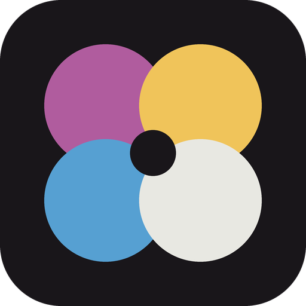

# Nikias's Hoard

Colouring studio for multi-colour 3D printing: gives a finished print figure a few colours and writes the files a slicer opens already painted. [Español](README.es.md)



## What it is

Colouring studio of the Hoard family. It opens a finished, single-colour print figure (an STL sculpt) and decides which
of a few colours (four by default) every triangle takes, from a textured model of the same figure or from pictures of
the character, which it looks up by itself when the figure brings none. The result is the digital file: a painted 3MF
the slicer opens with its colours. The person printing chooses the material for each colour. The figure itself is
untouched. Region and patch thresholds and the browser brush size are measured relative to the figure.

## What it does

- **Library**: point it at the folders where you keep your figures. It lists every STL grouped by folder, with its
  picture when a photo folder has one of the same name. Files named `<figure> flat.stl` and `<figure> pivot.stl` are
  shown inside their figure as variants, and `<figure> base.stl` or `<figure> <something>.stl` as its loose pieces.
- **Project**: opening a figure welds its triangles, measures it and cuts it into regions. Nothing is copied or
  changed in the figure's folder.
- **Regions**: a fused figure has no materials, but where two parts meet (a sleeve against an arm, a glove against
  its cuff, an engraved line) the surface folds inwards. Those folds separate the regions. An engraved outline
  rarely closes all the way round (it fades where it meets another), so the folds are widened until narrow gaps shut
  before they separate: the face, each eye, the inside of an ear or a headband come out as regions of their own even
  when their line has breaks. Two small pieces that this closing separates with nothing engraved between them (the
  white of an eye pinched between its lid and its iris) become one piece again. Detail 1-5 goes from big parts to every engraved line (4 by default). Regions are what
  gets a colour, by the model or by a click.
- **Colour from a textured model.** Add an OBJ, GLB, glTF or DAE, or use Blender to read an FBX or `.blend` with its saved pose.
  Nikias aligns the model to the figure and measures the fit. It samples nearby texture colours for each triangle,
  reduces them to the print palette and reports whether that palette covers the dominant reference colours.
  Automatic mode uses direct transfer when the model fits and vision-based colouring otherwise.
- **References of the character**: pictures dropped, pasted or picked from your folders, and "Buscar imagen del
  personaje", which looks the character up on the web by the figure's name and its collection: Pokémon take their
  official artwork (regional forms, Gigantamax and mega included), other collections the lead picture of the
  character's page on their wiki, and the encyclopedia when no wiki is known. The reference says which page it came
  from and is removed like any other. A figure with no references looks one up by itself before colouring (it can be
  switched off in Ajustes).
- **Colour directed by the vision model**: the model looks at the references, chooses the palette, writes down which
  colour each part of the character takes (hair, each piece of clothing, skin, eyes, soles, what it holds), and is
  then shown the figure one region at a time (the figure in clay with a single region marked, from the side where it shows
  most, with a close-up for small ones) and says which part it is and, from that table, its colour. Regions it finds mixed,
  or that hold a colour nobody received (eyes inside a head), are cut finer and asked again. Small parts that clash with everything around them (a pink finger on a white glove) are shown to it again in close-up,
  to say whether each is a feature of its own or more of what surrounds it. References reach it one by one and large,
  yours before the one looked up on the web. It then looks at its own
  colouring next to the references, with each region's number written on it, and corrects the parts it finds wrong.
  What it decided and why is kept in the project. An answer it cannot read is asked for once more; a review that
  fails costs the review, not the colouring.
- **Palette**: colours are compared in CIELAB and reduced with a weighted clustering that lets a small distinct
  colour keep its own. You can change a colour or its name, add or merge colours and choose which one is the
  object's own (colour 1, the one unpainted triangles take). A colour that ends on no face is dropped.
- **Painting by hand**: with "Pieza" (the tool a coloured figure opens with) the piece under the cursor lights up
  and a click fills it with the active colour; dragging still turns the figure, keys 1-9 choose the colour and
  Shift + click fills only the patch. "Mancha" fills the single-colour patch under the cursor, or drag a brush of
  a size set as a percentage of the figure's; Alt + click picks a colour; the last 20 changes can be undone.
- **Clean-up**: borders between colours are straightened and patches narrower than a percentage of the figure's
  size (1.2% by default) are merged into surrounding colours. Each colour shows its share of the surface and its patches.
- **Views**: colour, regions and clay, in the 3-D view and as pictures from any side or zoomed on
  a spot (shaded from the geometry, so engraved lines read as they will print).
- **Export.** Write painted 3MF for Bambu Studio / OrcaSlicer (`bambu`) or PrusaSlicer (`prusa`), a painted
  model for OrcaSlicer with external presets (`orca`), a standard-colour 3MF (`color`), an OBJ with one material per
  colour, or one STL surface per colour. The export includes a text palette. Flat and pivot variants that align
  with the figure can inherit its colours. Files go to `Multicolor` next to the figure or to a configured folder.
- **One solid per colour**: a multicolour 3MF in which every colour is its own closed mesh: as the parts of one
  object for Bambu Studio / OrcaSlicer (each part with its filament), as the volumes of one object for PrusaSlicer
  (each with its extruder), and as standard 3MF (a mesh object per colour with its colour as base material). The colour with the
  largest surface area forms the core. The other colours form skins with a configurable depth that tapers in thin areas.
  The export reports whether each resulting mesh is closed.
- **Printability**: the figure is checked for open edges, edges shared by more than two faces, faces turned the
  wrong way, shells pointing inwards, repeated and empty faces and dust, and its loose pieces are listed with
  those that would hang in the air. By default, exporting solids repairs the surface (repeated and empty faces and
  dust dropped, every shell made to face outwards, open rims closed). Each separate piece (a base, glasses) can also
  be written as its own STL standing on the plate.

## Connection with Faustus and Hoard Hub

The production handoff takes a closed print mesh and produces a coloured 3MF. For slicing through the Hub,
use `result_export` with `formats=["orca"]` and give the slicer filament presets in palette order.

`faustus-plugin.json` (id `nikias`) registers the app as a Faustus plugin: Hoard Hub starts it on demand on port 5252
and checks `/api/health`. The same operations the buttons use are available to assistants through MCP
(`mcp_server.py`, stdio); `figure_look` and `source_look` return pictures.

| Group | Tools |
| --- | --- |
| Library and projects | `status`, `library_scan`, `project_create`, `project_list`, `project_get`, `project_rename`, `project_delete` |
| References | `source_find`, `source_fetch`, `source_add`, `source_remove`, `source_look` |
| Colouring | `regions_set`, `color_start`, `job_status`, `job_cancel` |
| Palette and paint | `palette_set`, `paint`, `paint_undo`, `clean` |
| Views and files | `figure_look`, `result_export`, `print_check` |
| Settings | `settings_get`, `settings_set` |

Nikias also takes from the family's skill library the procedures its work needs and hands them to connecting agents
(button "Skills").

## Run

```
python -m venv .venv
.venv\Scripts\pip install -r requirements.txt
.venv\Scripts\python -m nikias_hoard
```

It listens on http://127.0.0.1:5252. Data lives in `data/` (`NIKIAS_DATA_DIR` to move it). Set the folders with your
figures, your references and your photos in Ajustes. Blender is found by itself (or set its path); it is only needed
for FBX and `.blend` references. The vision model is the one the family resolves through Hoard Link, or the
OpenAI-compatible server set in Ajustes. Tests: `python -m pytest`.

## Limits

- Colours are per triangle: a border between two colours follows the figure's own triangles, so its sharpness is
  that of the mesh. On dense sculpts that is finer than a nozzle.
- Direct transfer is intended for a textured model that fits the figure in the same pose. A different pose can be
  used as a visual reference.
- The vision model decides by regions. A colour change that no fold or engraved line marks (a pattern on a smooth
  surface) is not a region: it is painted with the brush or comes from a model that fits.
- Painted 3MF assigns colour slots per triangle. Choose the matching filament presets in the slicer using the
  exported palette. The separate solid-parts formats use a single-colour core and coloured outer skins.
- The picture looked up on the web is the lead one of the page named like the figure: when the file name is not the
  character's, it may bring something else; it shows under Referencias and can be removed.
- The vision model takes several minutes per figure (one question per dozen regions, plus the reviews).

## Project layout

- `nikias_hoard/engine/`: `mesh.py` (STL, welding, neighbours), `regions.py` (folds and regions), `source.py`
  (sampling a textured model, laying it over the figure, passing colours), `palette.py` (CIELAB, reduction),
  `labels.py` (smoothing, islands, brush), `render.py` (pictures), `export.py` (3MF, OBJ, STL), `printable.py` (check and repair), `solids.py` (one closed solid per colour), `export_parts.py` (the solids as 3MF), `modelio.py` (textured
  model readers), `pose.py` (part-by-part transfer for a model in another pose; not wired in yet), `blender.py` + `blender_export.py` (FBX and `.blend`).
- `nikias_hoard/director.py` (the vision model's direction), `llm.py` (its client).
- `nikias_hoard/services.py` (library, projects, references, jobs, palette, paint, export), `agent_tools.py` (the
  catalogue), `api/` (routes), `static/` (the studio), `store.py` (projects on disk).
- Data: `data/settings.json`, `data/projects/<id>/` (`project.json`, welded mesh, regions, colours, reference
  pictures), `data/mcp-token`.
- Tests: `tests/test_engine.py`, `tests/test_app.py`.

## Licence

[MIT](LICENSE). See [third-party notices](THIRD_PARTY_NOTICES.md).
